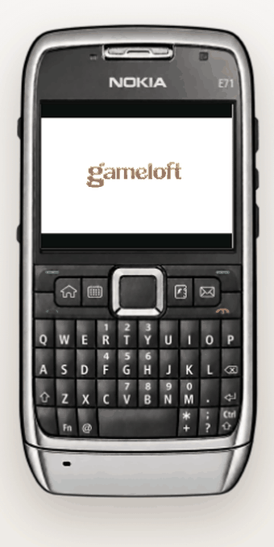
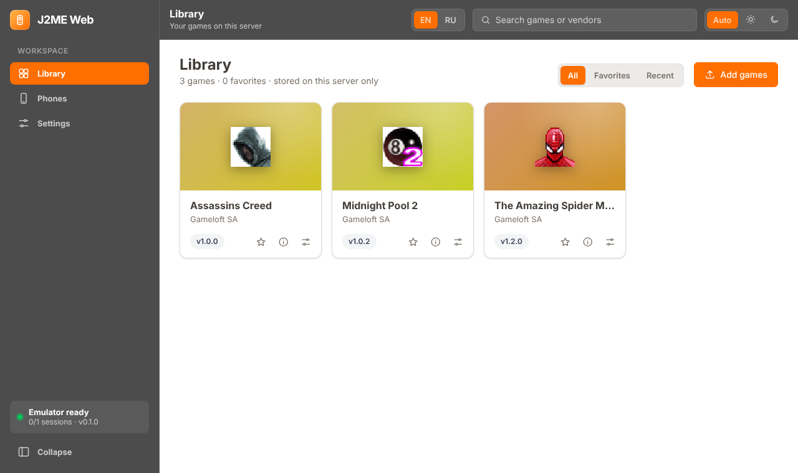
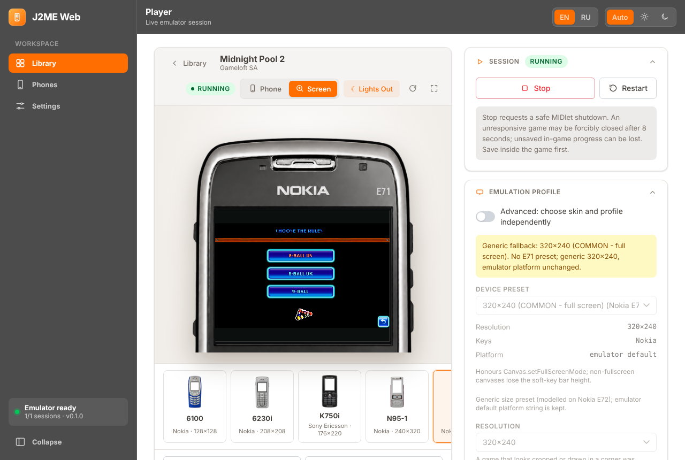
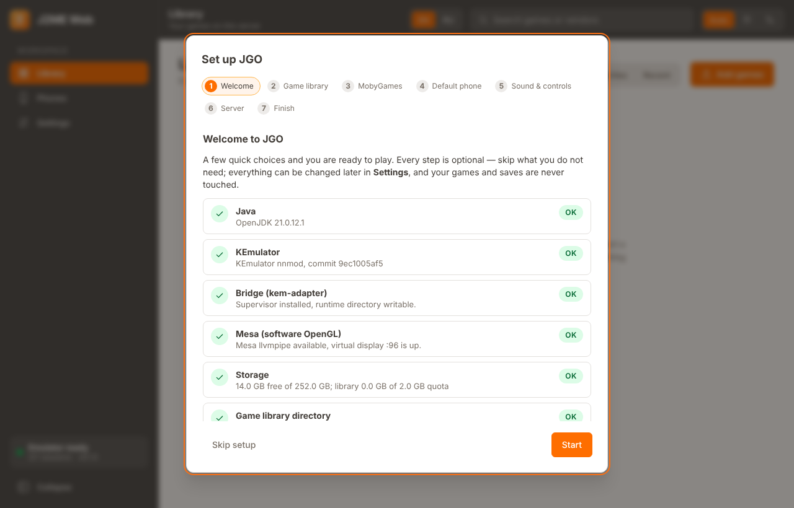
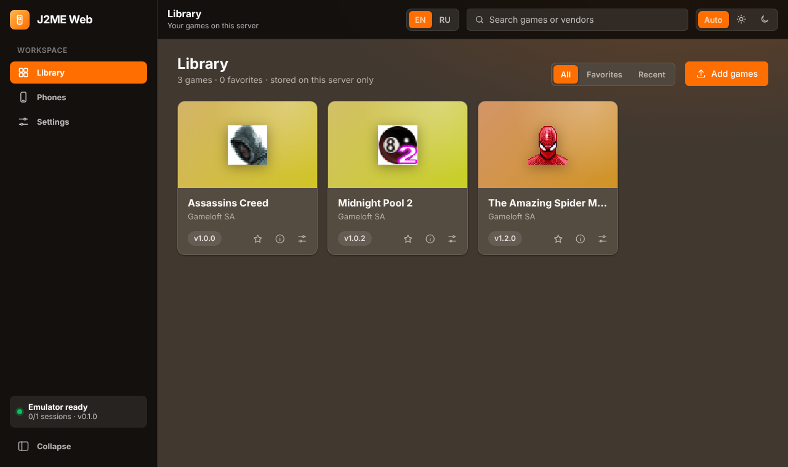
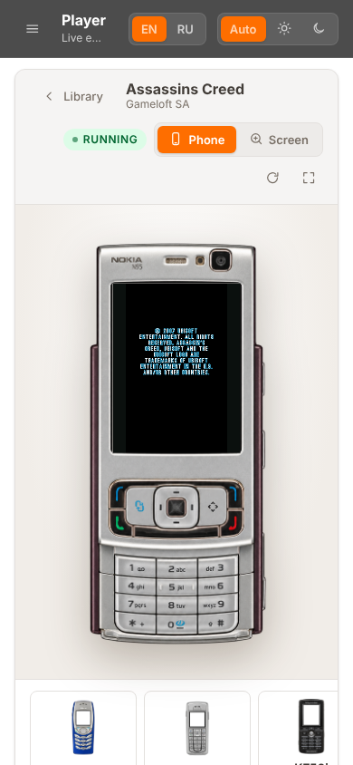

<div align="center">

# JGO

**A self-hosted web player for Java ME (J2ME) games.**
Games run in the real [KEmulator nnmod](https://github.com/shinovon/KEmulator) emulator on your server and open in any browser.

[](https://github.com/grayhex/JGO/actions/workflows/ci.yml)
[](#license)


English · [Русский](README.md)



</div>

## Features

**Emulation**
- Games are executed by [KEmulator nnmod](https://github.com/shinovon/KEmulator) on the server; the browser receives frames and audio and sends input events. Nothing is emulated in JavaScript.
- 2D, sound (MMAPI), RMS saves, 3D (M3G / JSR-184 on the Mesa llvmpipe software OpenGL renderer).
- 59 KEmulator device profiles: resolution, key layout, full-screen policy.
- A session lives on the server: reloading the page or losing the connection does not interrupt the game, and reopening it reattaches to the same session.

**Interface**
- Five handsets to choose from — Nokia 6100, 6230i, N95-1, E71, Sony Ericsson K750i; the live frame is shown inside the handset's display window without stretching, and the "Screen" view enlarges the display.
- Handset keys, an on-screen keypad, the PC keyboard, gamepads (remappable) and multi-touch.
- Picture rotation and a "landscape game" mode on the Nokia E71 for games made for another orientation; a hint when the manifest declares a screen size.
- Lights Out mode, full screen, light and dark themes, a responsive layout, English and Russian UI.

**Library**
- Drag-and-drop upload of JAR/JAD files or import of a whole directory (recursively): manifest and JAD, SHA-256, duplicate detection, several versions of one game.
- Library updates without re-importing; scans never delete games, settings, favourites or saves.
- Optional [MobyGames](https://www.mobygames.com) integration: covers, descriptions, genres, publishers, years, ratings, screenshots; J2ME platform first, manual choice for ambiguous matches.
- Without MobyGames the library works from the metadata inside the JAR files.

**Installation and operation**
- One-command installation into a Proxmox VE LXC container, modelled on [Proxmox VE Community Scripts](https://github.com/community-scripts/ProxmoxVE): no Docker, systemd, a dedicated service user.
- A first-run wizard and a Settings page: configuration is edited in the browser, not in config files.
- The `jgo` command: updates with SHA-256 verification and rollback, backups, restore, diagnostics.
- A game directory on the host is attached as a read-only bind mount.
- Docker Compose is available as a fallback.

**Security**
- Game code is treated as untrusted: a dedicated user, a systemd sandbox, cgroup limits, no network for games.
- Token authentication; secrets (the MobyGames key) stay on the server; the API reads files only inside explicitly allowed directories.

## Screenshots

<table>
<tr>
<td width="50%"><br><sub>Library</sub></td>
<td width="50%"><br><sub>Player: Nokia E71, landscape game</sub></td>
</tr>
<tr>
<td><br><sub>A portrait game in a Nokia N95-1</sub></td>
<td><br><sub>"Screen" view: enlarged display</sub></td>
</tr>
<tr>
<td><br><sub>First-run wizard: system status</sub></td>
<td><br><sub>Settings: game directory and import report</sub></td>
</tr>
<tr>
<td><br><sub>Dark theme</sub></td>
<td><br><sub>Mobile layout</sub></td>
</tr>
</table>

The games in the screenshots are Midnight Pool 2 and Assassin's Creed © Gameloft; they are not part of the repository.

## Quick start

### Proxmox VE (recommended)

Run in the Proxmox VE host shell:

```bash
bash -c "$(curl -fsSL https://raw.githubusercontent.com/grayhex/JGO/main/ct/jgo.sh)"
```

This creates an unprivileged Debian 13 LXC (4 CPU, 4 GB RAM, 20 GB disk) with Node.js 22, OpenJDK 21, Xvfb, Mesa, the Rust Bridge supervisor and KEmulator nnmod. The access token is printed at the end of the installation; show it later with `jgo token` inside the container.

Open `http://<container IP>:8080`, sign in with the token and go through the first-run wizard.

> Do not expose port 8080 to the internet without a VPN or a TLS proxy.

| Path | Purpose |
|---|---|
| `/opt/jgo` | the application (read-only for the service) |
| `/var/lib/jgo` | library, saves, settings |
| `/etc/jgo/jgo.env` | environment configuration and the token |

Details: [docs/PROXMOX.md](docs/PROXMOX.md); backups and migration: [docs/BACKUP.md](docs/BACKUP.md).

### Docker Compose

```bash
docker compose up --build
```

Open <http://localhost:8080>. The port is published on `127.0.0.1` only; set `AUTH_TOKEN` (at least 16 characters) before exposing it. The game container runs without root, with `read_only`, `cap_drop: ALL`, CPU/RAM/PID limits and no network access. Data lives in the `j2me-data` volume.

### From source

Requires Linux or WSL2, Node.js ≥ 22.13, OpenJDK 21, Rust, Xvfb and Mesa.

```bash
sudo apt install openjdk-21-jdk-headless git nodejs xvfb libgl1-mesa-dri
npm run setup      # builds KEmulator (pinned commit + patches), the Rust adapter and the web UI
npm start          # http://127.0.0.1:8080
```

3D needs a display with GLX: `Xvfb :99 -screen 0 640x480x24 +extension GLX &`, then `KEM_DISPLAY=:99 LIBGL_ALWAYS_SOFTWARE=1 npm start`. 2D and sound work without a display.

## Usage

1. **Add games.** Drop a `.jar` (and optionally a `.jad`) into the window, or connect a directory with your collection: *Settings → Game library → Scan library folder*. On Proxmox: `tools/proxmox/jgo-library-mount.sh <CTID> /path/on/host` (see [docs/LIBRARY.md](docs/LIBRARY.md)).
2. **Start a game.** Open its card and press *Start*. Sound begins after the first user action, as browsers require.
3. **Control it.** Digit and arrow keys, Enter as "Fire"; the handset keys; the on-screen keypad; a gamepad. Remap keys with *Keys…* and through the device profile.
4. **Adjust the screen.** A game that is cropped or drawn in a corner was made for a larger screen: JGO suggests the size declared in the manifest, and the resolution list includes 320×480 and 480×800. A game drawn "sideways" was made for landscape: the *Landscape* buttons rotate the picture and switch the handset to the Nokia E71, whose display is landscape. Rotation is a view only, the game is not told about it, and it is remembered per game.
5. **Leave with Stop.** Stopping calls the regular `destroyApp()`; RMS saves are written atomically.

## Compatibility

JGO runs what KEmulator runs: MIDP 2.0 / CLDC 1.0–1.1, class files of version ≤ 48 (genuine J2ME JARs; newer ones are rejected on upload with a clear message).

Checked manually with three commercial Gameloft titles (The Amazing Spider-Man, Assassin's Creed, Midnight Pool 2) and automatically with the project's own MIDlets: 2D, sound, M3G, RMS. Practical findings:
- many games from 2007–2012 are made for 320×480–480×800 screens and are cropped at 240×320; some are made for landscape;
- Mascot Capsule 3D has not been tested;
- `TextBox` and `List` screens are not implemented by the KEmulator Bridge front end;
- games have no network access (`jgo network allow` disables the isolation).

More: [docs/COMPATIBILITY.md](docs/COMPATIBILITY.md); batch static and dynamic analysis of your own collection: [docs/LAB.md](docs/LAB.md).

## Architecture

```
browser (React) ⇄ WebSocket / REST ⇄ apps/api (Fastify) ⇄ stdio ⇄ kem-adapter (Rust) ⇄ FIFO + mmap ⇄ KEmulator (JVM)
```

| Component | Purpose |
|---|---|
| `apps/web` | React + Vite: library, player, `PhoneSkin`, wizard and Settings, input, i18n |
| `apps/api` | Fastify: REST, WebSocket stream, SQLite library, sessions, import, MobyGames, limits, authentication |
| `bridge/kemulator-adapter` | Rust: Bridge handshake over FIFOs, framebuffer through mmap, process supervisor |
| `packages/protocol` | shared types and protocol constants |
| `runtime/` | KEmulator build, patches, Java audio mixer, Dockerfile |
| `packaging/`, `ct/`, `install/`, `json/` | release, the `jgo` command, systemd units, Proxmox VE scripts |
| `tools/` | handset skin tools, the Proxmox bind-mount helper, release preparation, README capture |

Technical notes:
- **Protocol.** Frames are sent as binary WebSocket messages; when a client falls behind, a stale frame is dropped (latency matters more than completeness). Frames can be deflate-compressed (`FRAME_ENCODING`). Audio is 44.1 kHz PCM played through an AudioWorklet (a ScriptProcessor fallback is used over plain `http://`).
- **Input.** Input sources (keyboard, gamepad, touches, handset keys) are reference-counted: several sources can hold one key, and focus loss or a disconnect releases only its own.
- **Handsets.** The handset picture is a layer over the live canvas; the emulated resolution does not depend on it. The display window comes from `config.json`; scaling is fit-without-stretching.
- **Sessions.** A WebSocket is only a viewer: the JVM lives until it is stopped or the idle timeout expires. Stop and SIGTERM call `destroyApp()`, and RMS writes go through a temporary file, fsync and an atomic rename. Save states are not emulated. See [docs/SESSION_RECOVERY.md](docs/SESSION_RECOVERY.md).
- **Library.** Content is addressed by SHA-256; the scanner does not follow symlinks and stays inside the allowed directories (`LIBRARY_ROOTS`); database migrations only add tables and columns, so rolling a release back is safe.
- **Emulator.** KEmulator nnmod v2.22, commit `9ec1005af5448bca63a420e1dfa884ef53842d0f`, built from source with a few patches (`runtime/patches`, described in [docs/BRIDGE.md](docs/BRIDGE.md)); KEmulator sources and binaries are not part of this repository.

More: [docs/ARCHITECTURE.md](docs/ARCHITECTURE.md).

## Configuration

Most settings are changed in *Settings*. Low-level values live in `/etc/jgo/jgo.env` (after editing: `systemctl restart jgo`):

| Variable | Default | Purpose |
|---|---|---|
| `HOST`, `PORT` | `0.0.0.0`, `8080` | listen address and port |
| `AUTH_TOKEN` | generated | access token (≥ 16 characters); without it the server listens on loopback only |
| `ALLOWED_ORIGINS` | — | extra origins behind a reverse proxy |
| `MAX_SESSIONS` | `1` | concurrent games (≈ 0.25–0.5 GB and one CPU core each) |
| `SESSION_MAX_MINUTES`, `SESSION_IDLE_MINUTES` | `120`, `5` | session length limit and idle timeout |
| `MAX_UPLOAD_MB`, `LIBRARY_QUOTA_MB` | `32`, `4096` | file size limit and library quota |
| `FRAME_ENCODING` | `deflate` | `deflate` or `raw` |
| `LIBRARY_ROOTS` | `/mnt/jgo-library /srv/jgo-library` | directories a game folder may be chosen from |
| `MOBYGAMES_API_KEY` | — | MobyGames key (normally entered in Settings) |
| `KEM_DISPLAY` | `:99` | X display for 3D |
| `KEM_JVM_ARGS`, `KEM_LAUNCH_WRAPPER` | see `jgo.env.example` | JVM options and network isolation |

The full list is in `packaging/jgo.env.example`.

## Administration

| Command | Action |
|---|---|
| `jgo status` | version, services, address, health, data size |
| `jgo update [--check] [--to vX.Y.Z]` | update: SHA-256, backup, health check, automatic rollback |
| `jgo backup` / `jgo restore FILE` | backup and restore (library, saves, settings, MobyGames key) |
| `jgo rollback` | return to the previous release |
| `jgo doctor [--online]` | check the system, sandbox, limits, access, game directory, backups |
| `jgo library` | library directories: attached, readable by the service |
| `jgo token [--rotate]` | show or replace the token |
| `jgo network [deny\|allow]` | network access of games |
| `jgo logs [-f]` | service logs |

## Security

- A game is untrusted code. The service runs as the `jgo` user without capabilities, with `NoNewPrivileges`, a system-call filter, `ProtectSystem=strict` and memory, process and CPU limits; the application is read-only to the service. Every game runs in its own network namespace without interfaces.
- `Host` and `Origin` checks, a token or cookie for every API endpoint except `/api/health`.
- The web UI and the API do not read files outside the allowed directories; paths are resolved with `realpath` and symlinks are not followed.
- The MobyGames key is stored in `secrets.json` (mode 0600) and is never returned by the API; images are downloaded by the server, and only from `mobygames.com` hosts.
- JGO does not download games from the internet.

Threat model and recommendations: [docs/SECURITY.md](docs/SECURITY.md).

## Development

```bash
npm run build          # production build
npm run build:dev      # build with developer tools (Lab, the skin alignment page)
npm test               # API and web unit tests
npm run test:integration   # tests against the real KEmulator: frames, input, RMS, 3D, sound, Bridge regressions
npm run test:e2e           # browser scenarios in Chromium
cargo test --manifest-path bridge/kemulator-adapter/Cargo.toml
python3 tools/phones/validate_assets.py   # handset asset validation (Pillow, NumPy)
```

CI runs the build, unit, integration and browser tests, and installs the project into a real unprivileged LXC container and into Docker. The production and developer-tool boundaries are described in [docs/PRODUCTION_DEVELOPMENT.md](docs/PRODUCTION_DEVELOPMENT.md). The pictures in this file are produced by `tools/docs/capture-readme.mjs` (bring your own JARs).

## Documentation

| Document | Contents |
|---|---|
| [PROXMOX.md](docs/PROXMOX.md) | installation, configuration, updates, diagnostics |
| [BACKUP.md](docs/BACKUP.md) | Proxmox Backup Server, `jgo backup`, migration |
| [LIBRARY.md](docs/LIBRARY.md) | wizard, settings, import, MobyGames |
| [UI.md](docs/UI.md) | interface, `PhoneSkin`, handsets |
| [PLAYER_CONTROLS.md](docs/PLAYER_CONTROLS.md) | device profiles, Lights Out, gamepads |
| [SESSION_RECOVERY.md](docs/SESSION_RECOVERY.md) | session recovery, RMS durability |
| [ARCHITECTURE.md](docs/ARCHITECTURE.md), [BRIDGE.md](docs/BRIDGE.md) | system design, Bridge patches |
| [COMPATIBILITY.md](docs/COMPATIBILITY.md), [LAB.md](docs/LAB.md) | compatibility and the lab |
| [SECURITY.md](docs/SECURITY.md) | security |

## Limitations

- A single owner (`default`); saves are isolated per game and version, there are no user accounts.
- One concurrent session by default.
- Handset skins are illustrations with *review draft* status: the geometry is checked automatically, historical accuracy is not confirmed.
- The MobyGames integration was tested against a local API stand-in; the terms of API use depend on your plan.

## Acknowledgements

- [KEmulator nnmod](https://github.com/shinovon/KEmulator) (shinovon) — the emulator JGO is built on.
- [Proxmox VE Community Scripts](https://github.com/community-scripts/ProxmoxVE) — the format and practices of the installation scripts.
- [MobyGames](https://www.mobygames.com) — metadata and images when the integration is enabled.

## License

The repository code is released under the MIT license. KEmulator nnmod is not shipped with the project: it is built from the upstream sources when a release or an image is built. Upstream contains code under GPLv3, Apache-2.0 and EPL (see the KEmulator README); before distributing built artifacts publicly, clarify the terms with the author or distribute the build scripts only. Game titles and trademarks belong to their owners.
