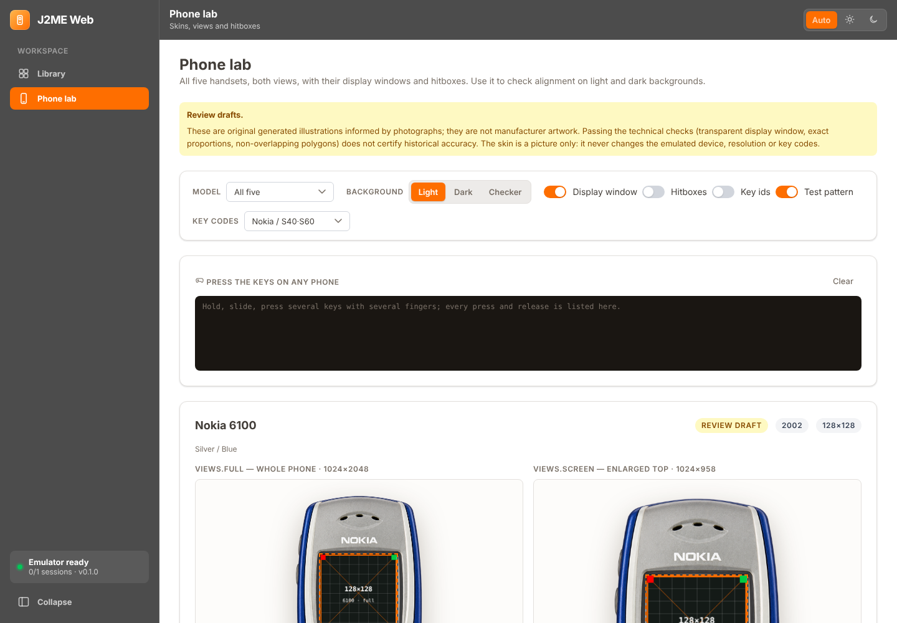

# J2ME Web

Self-hosted веб-плеер для Java ME (J2ME) игр. Игра исполняется **настоящим KEmulator nnmod** на сервере
(через его Bridge-фронтенд), в браузер идут кадры, звук и события; клавиатура, gamepad и экранная
клавиатура управляют игрой. Ничего не эмулируется на JavaScript.


## Установка в Proxmox VE (основной способ)

Одна команда в оболочке хоста Proxmox VE создаёт непривилегированный LXC на Debian 13 (4 CPU, 4 ГБ RAM, 20 ГБ диска), ставит Node.js 22,
OpenJDK 21, Xvfb + Mesa, Rust-супервизор Bridge и KEmulator nnmod и запускает всё под systemd от пользователя `jgo` — без Docker:

```bash
bash -c "$(curl -fsSL https://raw.githubusercontent.com/grayhex/JGO/main/ct/jgo.sh)"
```

После установки откройте `http://IP_КОНТЕЙНЕРА:8080`; токен доступа сгенерирован при установке (`jgo token` внутри контейнера).
Данные — `/var/lib/jgo`, конфигурация — `/etc/jgo`, приложение — `/opt/jgo`; управление — команда `jgo` (`status`, `update`, `backup`, `restore`, `logs`, `doctor`).
Обновление с проверкой SHA-256, резервной копией, проверкой работоспособности и откатом — `update` / `jgo update`.
**Не публикуйте порт 8080 в интернет** без VPN или TLS-прокси.

* [docs/PROXMOX.md](docs/PROXMOX.md) — установка, безопасность, лимиты, обновление, CLI, диагностика;
* [docs/BACKUP.md](docs/BACKUP.md) — Proxmox Backup Server, восстановление, перенос между контейнерами;
* скрипты в формате [Community Scripts](https://community-scripts.org/): `ct/jgo.sh`, `install/jgo-install.sh`, `json/jgo.json`;
  заготовка pull request в DevScripts — `packaging/devscripts/` (ничего не публикуется автоматически).

Установка проверяется автотестом на настоящем системном контейнере (`tests/lxc/run.sh`): установка, 2D, звук, M3G, песочница, RMS, бэкап, перенос, обновление и откат.

## Запасной вариант: Docker Compose

```bash
docker compose up --build
```

Откройте <http://localhost:8080>, перетащите в окно свой `.jar` (опционально и `.jad`) и нажмите **Start**.

* порт публикуется только на `127.0.0.1`; перед выставлением куда-либо ещё задайте `AUTH_TOKEN` (≥16 символов);
* контейнер игры: не root, `read_only`, `cap_drop: ALL`, `no-new-privileges`, лимиты CPU/RAM/PIDs, **сеть без выхода наружу**
  (игры не могут ходить в интернет; `docker compose -f compose.yaml -f compose.egress.yaml up` разрешает);
* данные (библиотека, SQLite, RMS-сохранения, логи) лежат в томе `j2me-data`;
* если Docker Hub отдаёт 429: `BASE_REGISTRY=mirror.gcr.io/library docker compose up --build`.

Требования: Docker (на Windows — Docker Desktop + WSL2), Linux x86_64 образ собирается ~2–3 минуты.
Этот вариант остаётся поддерживаемым и проверяется в CI (job `docker`), но не имеет `jgo` CLI, `update` с откатом и интеграции с Proxmox.

## Запуск из исходников (разработка; Linux / WSL2 Ubuntu)

```bash
sudo apt install openjdk-21-jdk-headless git nodejs xvfb libgl1-mesa-dri   # Node >= 22.13, Rust через rustup
npm run setup      # собирает KEmulator (pinned commit + патчи), Rust-адаптер, веб-интерфейс, тестовые MIDlet
npm start          # http://127.0.0.1:8080
```

3D (M3G / Mascot Capsule) требует X-дисплей с GLX: `Xvfb :99 -screen 0 640x480x24 +extension GLX &`,
затем `KEM_DISPLAY=:99 LIBGL_ALWAYS_SOFTWARE=1 npm start`. Без `KEM_DISPLAY` 2D и звук работают как есть.

## Первый запуск, настройки и импорт библиотеки

При первом открытии мастер предлагает: папку с играми (JAR/JAD, рекурсивно; на Proxmox — read-only bind mount хоста), ключ MobyGames (необязательно; обложки, описания, жанры, годы, рейтинги, скриншоты), телефон по умолчанию, звук, управление и лимиты сервера, и показывает состояние Java, KEmulator, Bridge, Mesa и хранилища. Всё меняется позже в **Settings**; секреты хранятся только на сервере, токен доступа не меняется, API не читает файлы вне разрешённых каталогов. Импорт находит дубли (SHA-256) и версии одной игры, обновляется без повторного импорта и не трогает сохранения. Игры из интернета не скачиваются. Подробнее: [docs/LIBRARY.md](docs/LIBRARY.md).

## Интерфейс и скины телефонов

Пять моделей на выбор (Nokia 6100, 6230i, N95-1, E71, Sony Ericsson K750i): живой экран KEmulator в прозрачном окне картинки телефона без растяжения,
кнопки корпуса с удержанием и мультитачем, вид «Screen» (увеличенный верх) с внешней панелью управления, страница `/phones` для проверки.
Скины — **review draft**, не исторический сертификат. Подробнее: [docs/UI.md](docs/UI.md).



## Лаборатория совместимости

Пакетный прогон **настоящих** игр (без добавления в Git): статический анализ JAR (M3G, Mascot Capsule, Nokia UI, Sony Ericsson и др. против реального списка классов эмулятора),
FPS/CPU/RAM/логи/звук/скриншоты, HTML-отчёт с ручной оценкой, device-пресеты KEmulator (модель, разрешение, раскладка клавиш).

```bash
npm run lab -- run ~/j2me-games --out lab-out      # открыть lab-out/report.html
npm run lab -- analyze ~/j2me-games                 # только статический анализ
npm run lab -- devices                              # 59 пресетов KEmulator
```

Подробнее: [docs/LAB.md](docs/LAB.md). Исправления Bridge, найденные лабораторией: [docs/BRIDGE.md](docs/BRIDGE.md).

## Что внутри

```
browser (React) ⇄ WS/REST ⇄ apps/api (Fastify) ⇄ stdio ⇄ kem-adapter (Rust) ⇄ FIFO + mmap ⇄ KEmulator nnmod (JVM)
```

| Путь | Назначение |
|---|---|
| `apps/web` | React + Vite: дизайн-система Command Center, библиотека, плеер, `PhoneSkin` (5 моделей, hitboxes, мультитач), страница `/phones`, ввод |
| `apps/api` | Fastify: REST, WebSocket-поток, библиотека (SQLite), сессии, лимиты, авторизация |
| `bridge/kemulator-adapter` | Rust: FIFO-рукопожатие Bridge, mmap фреймбуфера, процесс-супервизор |
| `packages/protocol` | общие типы/константы WS-протокола |
| `runtime/` | Dockerfile, сборка KEmulator, **патчи**, Java-микшер звука |
| `design/phones`, `tools/phones` | исходники и скрипты экспорта/проверки скинов телефонов (`apps/web/public/phones`) |
| `tests/` | тестовые MIDlet (2D, M3G), интеграционные и e2e тесты |
| `docs/` | Proxmox/LXC, резервные копии, архитектура, Bridge, совместимость, безопасность, лаборатория (Cloudflare — архивная оценка) |

Версия эмулятора: **KEmulator nnmod v2.22, commit `9ec1005af5448bca63a420e1dfa884ef53842d0f`** — собирается из исходников
с 4 небольшими патчами (`runtime/patches`, причины в [docs/BRIDGE.md](docs/BRIDGE.md)). Бинарники и исходники KEmulator в репозиторий не входят.

## API

`GET /api/health`, `GET|POST /api/games`, `PATCH|DELETE /api/games/:id`, `POST /api/sessions`,
`GET|DELETE /api/sessions/:id`, `WS /api/sessions/:id/stream`. Подробнее — [docs/ARCHITECTURE.md](docs/ARCHITECTURE.md).

## Тесты

```bash
npm test                    # юнит: парсер JAR, пресеты, анализатор, геометрия скинов и разбор hitboxes.svg
python3 tools/phones/validate_assets.py   # ассеты скинов телефонов (Pillow, NumPy)
cargo test --manifest-path bridge/kemulator-adapter/Cargo.toml
npm run test:integration    # тесты на НАСТОЯЩЕМ KEmulator: кадры, ввод, RMS, краш, 3D, звук, auth, пресеты, регрессии Bridge
npm run test:e2e            # настоящий Chromium: загрузка, игра, клавиши, звук; скины, hitboxes, мультитач, zoom; мастер, импорт, MobyGames (заглушка)
bash tests/scripts/library-mount.test.sh   # bind mount хоста Proxmox (поддельный pct)
BASE=http://127.0.0.1:8080 node tests/e2e/container-smoke.mjs   # против запущенного docker compose
```

## Ограничения (кратко; детали в docs/COMPATIBILITY.md)

* KEmulator принимает только class-файлы версии ≤ 48 (то есть настоящие J2ME-JAR); новее — понятная ошибка при загрузке.
* **Коммерческие игры (Gameloft, Nokia, SE) в рамках разработки не тестировались** — их нет в репозитории и они не скачивались.
  Проверено на собственных свободных MIDlet (2D, M3G, звук, RMS). Mascot Capsule не проверялся.
* Экраны `TextBox` / `List` Bridge-фронтенд KEmulator пока не реализует (`Not implemented` в самом эмуляторе).
* Одна активная сессия по умолчанию (`MAX_SESSIONS`); архитектура рассчитана на несколько.
* Пользователи: пока один владелец (`default`); изоляция сохранений по играм/версиям есть, по пользователям — заготовка (`saves/<owner>/<game>`).

## Лицензии

Код этого репозитория — MIT. KEmulator nnmod не содержит файла лицензии в репозитории и включает код
под GPLv3/Apache-2.0/EPL (см. README апстрима): поэтому он **не поставляется** вместе с проектом, а собирается
из апстрима при сборке образа; перед публичным распространением собранных образов нужно уточнить условия у автора
(shinovon) или распространять только скрипты сборки.

## Профили, Lights Out и геймпады

Телефон автоматически выбирает существующий device-пресет KEmulator; Advanced разрешает независимый выбор. Настройки сохраняются для каждой игры. В Screen-виде кнопка ☾ и Alt+L включают Lights Out, Escape выключает. Настройки геймпада позволяют переназначать кнопки/оси глобально или для игры. Таблица соответствий и подробности: [PLAYER_CONTROLS.md](docs/PLAYER_CONTROLS.md).

## Надёжность и режим разработки

Обновление страницы и обрыв сети восстанавливают подключение к живой сессии; после рестарта сервера игра запускается заново с её сохранениями RMS. Завершение вызывает настоящий `destroyApp()`, записи RMS выполняются атомарно. Save states не имитируются. Подробнее: [SESSION_RECOVERY.md](docs/SESSION_RECOVERY.md).

По умолчанию собирается production-приложение; Lab и диагностические страницы доступны отдельными dev-командами. Developer Mode включается в настройках. Переключатель EN/RU находится при входе и в шапке, EN — язык по умолчанию. Границы релиза и команды: [PRODUCTION_DEVELOPMENT.md](docs/PRODUCTION_DEVELOPMENT.md).
