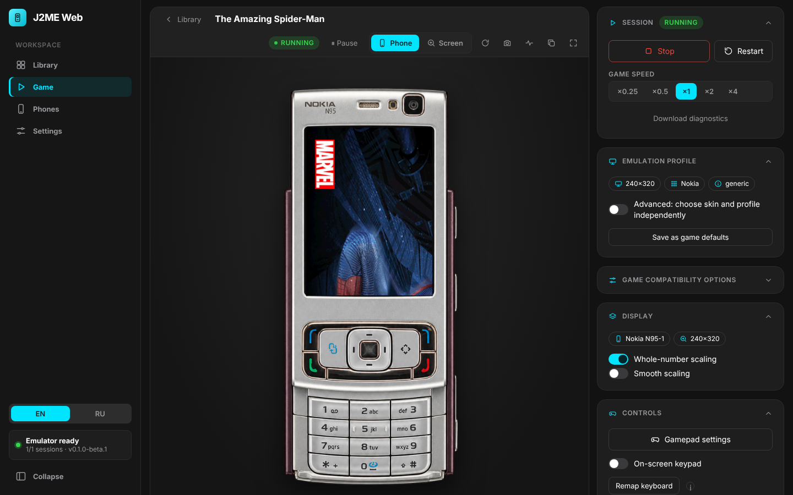

<div align="center">

# JGO

**Self-hosted веб-плеер для игр Java ME (J2ME).**
Игры работают в настоящем эмуляторе [KEmulator nnmod](https://github.com/shinovon/KEmulator) на вашем сервере и открываются в любом браузере.

[](https://github.com/grayhex/JGO/actions/workflows/ci.yml)
[](#лицензия)


[English](README.en.md) · Русский



</div>

## Возможности

- **Настоящий эмулятор.** Игры исполняет KEmulator nnmod на сервере; в браузер передаются кадры, звук и ввод.
- **2D, звук, 3D.** MIDP 2.0 / CLDC 1.1, MMAPI, RMS-сохранения, M3G (JSR-184) на программном OpenGL.
- **59 профилей устройств:** разрешение, раскладка клавиш, полноэкранный режим.
- **Сессии на сервере.** Обновление страницы и обрыв сети не прерывают игру.
- **Десять телефонов** на выбор: Nokia 6100, 6230i, N95-1, E71, 5800 XpressMusic; Sony Ericsson K750i, W995, K790i; Motorola RAZR V3; Samsung S5230 Star. У каждого есть полный вид и приближение экрана.
- **Управление:** кнопки корпуса, экранная клавиатура, клавиатура ПК, геймпад, мультитач.
- **Экран:** поворот картинки, альбомный режим, полный экран, светлая и тёмная темы, русский и английский интерфейс.
- **Библиотека:** загрузка JAR/JAD перетаскиванием или импорт каталога; поиск дубликатов; необязательные метаданные [MobyGames](https://www.mobygames.com).
- **Установка в один шаг** в LXC-контейнер Proxmox VE, команда `jgo` для обновлений и резервных копий. Запасной вариант — Docker Compose.
- **Безопасность:** игра — недоверенный код: отдельный пользователь, песочница systemd, лимиты ресурсов, нет доступа к сети.

<div align="center">

</div>

## Быстрый старт

### Proxmox VE (рекомендуется)

Выполните в оболочке хоста Proxmox VE:

```bash
bash -c "$(curl -fsSL https://raw.githubusercontent.com/grayhex/JGO/main/ct/jgo.sh)"
```

Будет создан непривилегированный LXC на Debian 13 (4 CPU, 4 ГБ RAM, 20 ГБ диска). Токен доступа выводится в конце установки, позже его покажет `jgo token`. Откройте `http://<IP контейнера>:8080`, войдите по токену и пройдите мастер первого запуска.

> Не публикуйте порт 8080 в интернет без VPN или TLS-прокси.

| Путь | Назначение |
|---|---|
| `/opt/jgo` | приложение |
| `/var/lib/jgo` | библиотека, сохранения, настройки |
| `/etc/jgo/jgo.env` | конфигурация и токен |

Подробности: [docs/PROXMOX.md](docs/PROXMOX.md), резервные копии — [docs/BACKUP.md](docs/BACKUP.md).

### Docker Compose

```bash
docker compose up --build
```

Откройте <http://localhost:8080>. Порт доступен только на `127.0.0.1`; перед публикацией задайте `AUTH_TOKEN` (не короче 16 символов).

### Из исходников

Нужны Linux или WSL2, Node.js ≥ 22.13, OpenJDK 21, Rust, Xvfb и Mesa.

```bash
sudo apt install openjdk-21-jdk-headless git nodejs xvfb libgl1-mesa-dri
npm run setup      # сборка KEmulator, Rust-адаптера и веб-интерфейса
npm start          # http://127.0.0.1:8080
```

Для 3D нужен дисплей с GLX: `Xvfb :99 -screen 0 640x480x24 +extension GLX &`, затем `KEM_DISPLAY=:99 LIBGL_ALWAYS_SOFTWARE=1 npm start`.

## Использование

1. **Добавьте игры:** перетащите `.jar` (и `.jad`) в окно или подключите каталог — *Settings → Game library*. Для Proxmox: `tools/proxmox/jgo-library-mount.sh <CTID> /путь/на/хосте` ([docs/LIBRARY.md](docs/LIBRARY.md)).
2. **Запустите** игру кнопкой *Start*. Звук включается после первого действия пользователя — так требует браузер.
3. **Управляйте** цифрами и стрелками (Enter — «Fire»), кнопками телефона, экранной клавиатурой или геймпадом. Раскладка — кнопка *Keys…*.
4. **Подберите экран.** Если игра обрезана, выберите большее разрешение (JGO предложит то, что указано в манифесте). Если нарисована «боком» — нажмите *Landscape*.
5. **Выходите через Stop:** вызывается штатный `destroyApp()`, сохранения RMS записываются атомарно.

## Совместимость

Поддерживаются MIDP 2.0 / CLDC 1.0–1.1 и class-файлы версии ≤ 48 (настоящие J2ME-JAR). Известные ограничения:

- ввод текста в `TextField`/`TextBox` не поддерживается: экраны отображаются, но набирать в них нельзя;
- у игр нет доступа к сети (`jgo network allow` отключает изоляцию);
- не проверялись Mascot Capsule 3D, видео и камера.

Полная матрица функций — [docs/EMULATOR_FEATURE_MATRIX.md](docs/EMULATOR_FEATURE_MATRIX.md); подробности — [docs/COMPATIBILITY.md](docs/COMPATIBILITY.md).

## Конфигурация

Большинство параметров меняется в *Settings*. Низкоуровневые значения — в `/etc/jgo/jgo.env` (после правки: `systemctl restart jgo`):

| Переменная | По умолчанию | Назначение |
|---|---|---|
| `HOST`, `PORT` | `0.0.0.0`, `8080` | адрес и порт |
| `AUTH_TOKEN` | генерируется | токен доступа (≥ 16 символов) |
| `ALLOWED_ORIGINS` | — | дополнительные origin за обратным прокси |
| `MAX_SESSIONS` | `1` | число одновременных игр |
| `SESSION_MAX_MINUTES`, `SESSION_IDLE_MINUTES` | `120`, `5` | предел длительности и таймаут простоя |
| `MAX_UPLOAD_MB`, `LIBRARY_QUOTA_MB` | `32`, `4096` | размер файла и квота библиотеки |
| `LIBRARY_ROOTS` | `/mnt/jgo-library /srv/jgo-library` | каталоги, откуда можно импортировать игры |
| `MOBYGAMES_API_KEY` | — | ключ MobyGames (обычно вводится в Settings) |

Полный список — `packaging/jgo.env.example`.

## Команда `jgo`

| Команда | Действие |
|---|---|
| `jgo status` | версия, службы, адрес, health |
| `jgo update [--check] [--to vX.Y.Z]` | обновление с проверкой SHA-256 и автоматическим откатом |
| `jgo backup` / `jgo restore FILE` | резервная копия и восстановление |
| `jgo rollback` | вернуться к предыдущему релизу |
| `jgo doctor [--online]` | диагностика системы |
| `jgo library` | состояние каталогов библиотеки |
| `jgo token [--rotate]` | показать или заменить токен |
| `jgo network [deny\|allow]` | сетевой доступ игр |
| `jgo logs [-f]` | журнал служб |

## Архитектура

```
браузер (React) ⇄ WebSocket / REST ⇄ apps/api (Fastify) ⇄ kem-adapter (Rust) ⇄ KEmulator (JVM)
```

| Каталог | Назначение |
|---|---|
| `apps/web` | React + Vite: библиотека, плеер, телефоны, настройки |
| `apps/api` | Fastify: REST, WebSocket, SQLite-библиотека, сессии |
| `bridge/kemulator-adapter` | Rust: связь с KEmulator Bridge |
| `packages/protocol` | общие типы протокола |
| `runtime/` | сборка KEmulator и патчи |
| `packaging/`, `ct/`, `install/` | релиз, команда `jgo`, установка Proxmox VE |

Подробнее: [docs/ARCHITECTURE.md](docs/ARCHITECTURE.md). KEmulator nnmod v2.22 (коммит `9ec1005`) собирается из исходников с небольшими патчами ([docs/BRIDGE.md](docs/BRIDGE.md)); его код в репозиторий не входит.

## Безопасность

- Сервис работает от пользователя `jgo` без capabilities, с `NoNewPrivileges`, фильтром системных вызовов и лимитами; каждая игра — в собственном сетевом пространстве имён без интерфейсов.
- Токен или cookie для всех эндпоинтов API, кроме `/api/health`; проверки `Host` и `Origin`.
- API не читает файлы вне разрешённых каталогов; ключ MobyGames хранится с правами 0600 и не возвращается клиенту.
- JGO не скачивает игры из интернета.

Подробнее: [docs/SECURITY.md](docs/SECURITY.md).

## Разработка

```bash
npm run build              # production-сборка
npm test                   # юнит-тесты
npm run test:integration   # тесты на настоящем KEmulator
npm run test:e2e           # браузерные сценарии (Chromium)
cargo test --manifest-path bridge/kemulator-adapter/Cargo.toml
```

## Документация

| Документ | Содержание |
|---|---|
| [PROXMOX.md](docs/PROXMOX.md), [BACKUP.md](docs/BACKUP.md) | установка, обновление, резервные копии |
| [LIBRARY.md](docs/LIBRARY.md) | мастер, настройки, импорт, MobyGames |
| [UI.md](docs/UI.md), [PLAYER_CONTROLS.md](docs/PLAYER_CONTROLS.md) | интерфейс, телефоны, управление |
| [SESSION_RECOVERY.md](docs/SESSION_RECOVERY.md) | восстановление сессий, сохранения RMS |
| [ARCHITECTURE.md](docs/ARCHITECTURE.md), [BRIDGE.md](docs/BRIDGE.md) | устройство системы, патчи Bridge |
| [EMULATOR_FEATURE_MATRIX.md](docs/EMULATOR_FEATURE_MATRIX.md) | покрытие возможностей KEmulator |
| [COMPATIBILITY.md](docs/COMPATIBILITY.md), [LAB.md](docs/LAB.md) | совместимость, лаборатория |
| [SECURITY.md](docs/SECURITY.md) | безопасность |

## Благодарности

- [KEmulator nnmod](https://github.com/shinovon/KEmulator) (shinovon) — эмулятор, на котором построен JGO.
- [Proxmox VE Community Scripts](https://github.com/community-scripts/ProxmoxVE) — формат скриптов установки.
- [MobyGames](https://www.mobygames.com) — метаданные при включённой интеграции.

## Лицензия

Код репозитория распространяется по лицензии MIT. KEmulator nnmod не поставляется вместе с проектом: он собирается из исходников апстрима. Апстрим содержит код под GPLv3, Apache-2.0 и EPL (см. README KEmulator); перед публичным распространением собранных артефактов уточните условия у автора. Названия игр и торговые марки принадлежат их владельцам.
