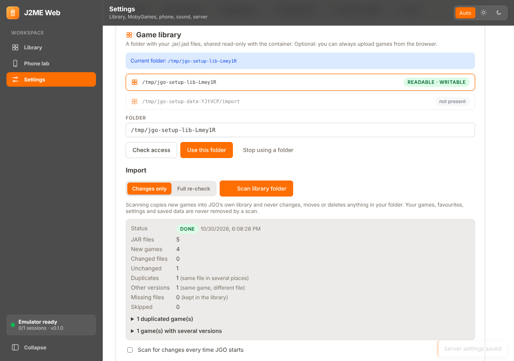

# Мастер первого запуска, настройки, импорт библиотеки и MobyGames

## Первый запуск

После входа (прежний токен JGO, `jgo token`) на **свежей** установке открывается мастер: проверка системы → папка с играми → MobyGames → телефон по умолчанию → звук и управление → параметры сервера → импорт. Каждый шаг можно пропустить, все значения потом меняются в **Settings** без правки конфигов; мастер можно запустить снова (Settings → *Run the setup wizard again*).

**Существующие установки не затрагиваются.** Если в библиотеке уже есть игры, а файла настроек нет, мастер не показывается, поведение прежнее (240×320, раскладка Nokia, лимиты из `/etc/jgo/jgo.env`). Настройки пишутся только когда вы их меняете. Значения из `jgo.env` остаются значениями по умолчанию: в `settings.json` хранятся только отличающиеся (правка `jgo.env` продолжает работать).

## Что и где хранится

| Файл (`/var/lib/jgo`) | Содержимое |
|---|---|
| `settings.json` (0600) | настройки из веб-интерфейса: папка, телефон по умолчанию, звук, управление, лимиты |
| `secrets.json` (0600) | **ключ MobyGames** — только на сервере; API его никогда не возвращает (только «задан / последние 4 символа») |
| `library.sqlite` | игры, источники импорта, результаты MobyGames (таблицы добавляются миграцией; предыдущий релиз их игнорирует, `jgo rollback` работает) |
| `metadata/<группа>/` | обложки и скриншоты MobyGames, отдаются самим JGO (`/api/games/:id/cover`) |
| `saves/` | RMS-сохранения: импорт и обновление библиотеки их не трогают |

Токен доступа, адрес и порт задаются при установке (`/etc/jgo/jgo.env`) и из веб-интерфейса не меняются. `jgo backup` / `jgo restore` включают настройки, ключ и данные MobyGames (архивы `0600`; храните их как секрет).

## Состояние системы

Settings → System (и первый шаг мастера): Java, KEmulator, Bridge (`kem-adapter`), Mesa/виртуальный дисплей для 3D, хранилище (свободное место, квота), папка библиотеки, MobyGames. У каждой проверки — статус и подсказка, как исправить. В ответах нет путей хоста.

## Папка с играми

* Разрешены только каталоги из `LIBRARY_ROOTS` (по умолчанию `/mnt/jgo-library`, `/srv/jgo-library`) и `<data>/import`. Путь проверяется по `realpath`: `..` и символические ссылки не выводят за пределы. Обход не заходит в симлинки, глубина ≤ 16, ≤ 100 000 записей.
* *Check access*: существует ли, читается ли пользователем `jgo`, сколько JAR/JAD (рекурсивно), предупреждение, если каталог доступен на запись (JGO туда никогда не пишет).
* Подключение каталога хоста — read-only bind mount, см. [PROXMOX.md](PROXMOX.md#библиотека-игр-с-хоста-read-only-bind-mount).
* Папку можно не указывать: загрузка из браузера работает как раньше.

## Импорт

Рекурсивно: `.jar` + `.jad` с тем же именем (или единственная пара в каталоге) → `META-INF/MANIFEST.MF` и JAD (атрибуты JAD главнее), иконка, версия класс-файлов, SHA-256. Новая игра копируется в библиотеку JGO (`games/<sha>/`) — так игра, её настройки и сохранения не зависят от папки.

* **Дубли**: тот же SHA-256 по нескольким путям — одна игра, пути перечислены в отчёте.
* **Версии**: тот же издатель и название, но другие байты — отдельные версии одной игры (в библиотеке выбираются списком у карточки).
* **Обновление без повторного импорта**: режим *Changes only* пропускает файлы с прежними размером и датой (не читает и не хэширует), *Full re-check* перехэширует всё. Изменившийся файл становится новой версией; прежняя версия, её настройки и сохранения остаются.
* **Исчезнувшие файлы** только помечаются («file gone»); игры и сохранения не удаляются. Если папка пуста, хотя раньше в ней были файлы (например, не смонтирован том), ничего не помечается.
* Игры получают «телефон по умолчанию» (разрешение, раскладка, куча, профиль устройства).
* Ошибочные файлы попадают в отчёт (относительный путь + причина) и не останавливают импорт. Лимит размера файла — `MAX_UPLOAD_MB`, общий объём — квота библиотеки.
* Автозапуск: *Scan for changes every time JGO starts* (Settings → Game library).

## MobyGames

Необязательно. Без ключа библиотека работает с метаданными JAR.

* Ключ вводится самим пользователем (Settings → MobyGames, шаг мастера), хранится в `secrets.json`, проверяется кнопкой *Test key*, удаляется кнопкой *Remove key*. Можно задать и через `MOBYGAMES_API_KEY` в окружении (ключ из Settings главнее).
* API v2 (`https://api.mobygames.com/v2`, `api_key`): один запрос `GET /games?title=…&platform=<J2ME>&fuzzy=true&include=…` на игру приносит описание, жанры, издателей, разработчиков, год, MobyScore, обложки и скриншоты. Платформа J2ME находится по имени через `/platforms`. Сначала ищем среди J2ME; если там пусто — по всем платформам (такой результат всегда уходит на ручной выбор).
* **Автоматически** выбирается только ясный случай: игра для J2ME, название практически идентично и нет равного соперника. Иначе — **ручной выбор**: список кандидатов с платформой и совпадением названия, поиск по другому названию, *Wrong game?* / *Remove information*. Ручной выбор не перезаписывается обновлением.
* Запросы идут по одному с паузой (≥ 1,1 с), 429 обрабатывается ожиданием `Retry-After`; если тариф не включает поля оценок, запрос повторяется с базовым набором полей. Задание можно остановить.
* Метаданные общие для всех версий игры. Картинки скачиваются **сервером** только с хостов `mobygames.com` (проверяются сигнатура и размер), браузер к MobyGames не обращается.
* **Атрибуция и условия**: везде, где показаны данные, есть строка «Game data and images courtesy of MobyGames» и ссылка на страницу игры; данные хранятся локально для личного использования, не раздаются, обновляются по TTL 30 дней, **Settings → Delete all MobyGames data** удаляет всё. Ключ даёт доступ по условиям вашего тарифа MobyGames (по сведениям из открытых источников ключ платный с сентября 2024 г.): проверьте их сами.
* **Игры из интернета не скачиваются**: клиент умеет только запрашивать метаданные и картинки.

## Ограничения

* Страница условий MobyGames (`mobygames.com/info/api`) при разработке была недоступна (HTTP 403): атрибуция и срок хранения сделаны консервативно по общим правилам и должны быть сверены вами с вашим тарифом. Структура ответов — по документации Postman; интеграция проверена на локальной заглушке API, **с настоящим сервисом не проверялась**.
* Рейтинги: MobyScore всегда; оценки критиков и игроков (`critic_score`, `player_score`) запрашиваются, но доступны только на старших тарифах.
* Веб-интерфейс проверен в Chromium; bind mount проверен скриптом-тестом с поддельным `pct`, на живом Proxmox VE не проверялся.
